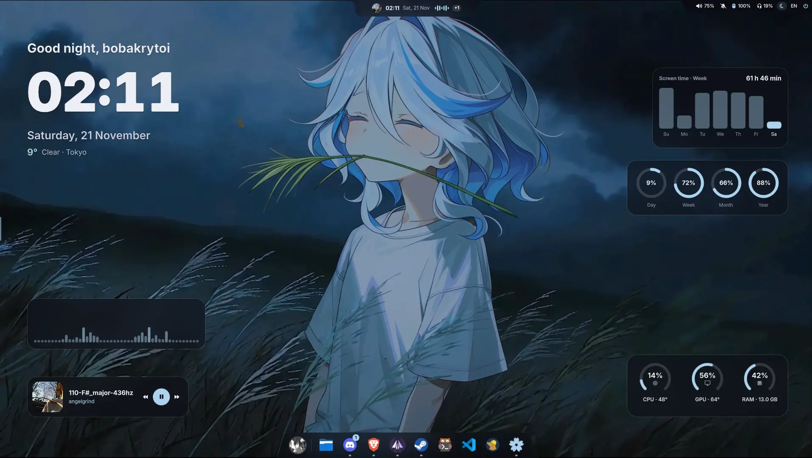
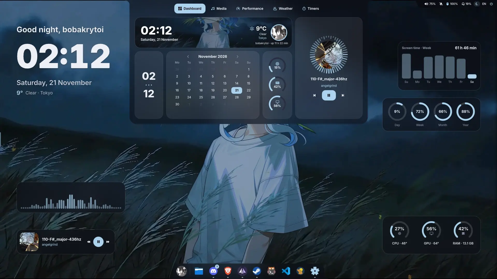
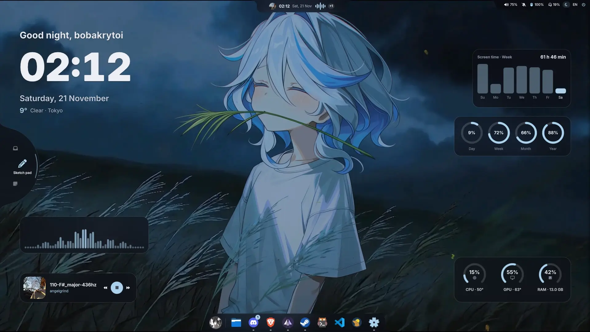

# sakura mono

My Arch + Hyprland setup. The whole desktop (bar, dock, start menu, notifications, lock screen,
settings app and so on) is written in Quickshell, there is no waybar or swaync anymore.
Colors follow the wallpaper.



Dashboard (click the clock) and the edge drum on the left side:




Made for Hyprland 0.57 with the Lua config and quickshell 0.3. I run it on two 1080p monitors with an
NVIDIA card, other setups should work but I haven't tested much.

## What's in it

- top bar with a notch that shows media, volume, recording state
- start menu with search (apps, files, calculator, currency, commands), right click on an app for jump list, file location, force quit, uninstall
- dock, alt+tab with window previews, minimize animation into the bar
- settings app: displays, sound, colors (vibrance, night light), network, keyboard/mouse, RGB
- notification center, OSD, clipboard history, screenshot editor with OCR
- desktop widgets, a small mascot, hot corners, edge drum with ambient sounds
- capture overlay (instant replay / recording via gpu-screen-recorder)
- lock screen and an SDDM theme that look the same, Plymouth splash
- password helper (vault key lives in gnome-keyring)
- Sakura Cam: use an iPhone as a webcam through Safari, no app needed (needs v4l2loopback, see config/hypr/scripts/sakura-cam/README.md)
- Sakura Sound: a separate SoundCloud player (own quickshell config + python backend)
- task manager, calculator, file converter and archive menus for Dolphin
- accent color is picked from the wallpaper and pushed to kitty, qt6ct, Kvantum, rofi and a Vencord theme

## Dependencies

Everything is in `packages.txt` (official repos) and `aur.txt` (AUR). Main ones:

```
hyprland quickshell uwsm qt6-multimedia qt6-5compat kitty rofi swayosd awww cava
cliphist wl-clipboard grim slurp satty imagemagick ffmpeg mpv yt-dlp gpu-screen-recorder
papirus-icon-theme inter-font ttf-jetbrains-mono-nerd sddm plymouth
```

## Install

```bash
git clone https://github.com/bobakrytoi/sakura-dots
cd sakura-dots
./install.sh --packages    # or just ./install.sh if you have the packages
```

The installer moves anything it would overwrite to `~/.sakura-backup-<date>`, so you can go back.
Then log out and pick Hyprland (uwsm). Monitors are set in Settings > Displays.

Login screen and boot splash need root, so they are a separate step:

```bash
./system/install-system.sh
```

## Notes

- Some files can't use `$HOME` (desktop entries, qt6ct, xdph, a few generated configs), so they have
  `__HOME__` in the repo. `install.sh` replaces it with your home. Same for `__USER__` in the SDDM theme.
- The SDDM xsetup script picks the main monitor by its EDID serial (useful with two identical screens).
  The serial isn't in the repo, pass yours to `install-system.sh` or put it in
  `/usr/local/share/sakura/main-monitor-serial` (see `system/sddm/main-monitor-serial.example`).
- `config/hypr/monitors.lua` is written by the settings app, there is an example next to it.
- The weather widget finds your city by IP on first run.
- Only one wallpaper is included, drop your own into `~/Pictures/Wallpapers`.

## Layout

```
config/    -> ~/.config
local/     -> ~/.local (bin, icons, cursor, sounds, desktop files, Dolphin menus)
system/    SDDM bits, Plymouth theme, install-system.sh
wallpapers -> ~/Pictures/Wallpapers
```
